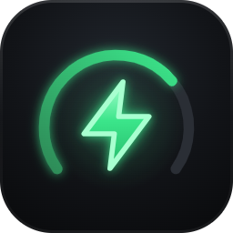

# Wallbox WEB per Home Assistant

🇬🇧 [English](README.md)

[](https://my.home-assistant.io/redirect/hacs_repository/?owner=Filpin011&repository=ha-wallbox-web&category=integration)
[](https://my.home-assistant.io/redirect/config_flow_start/?domain=wallbox_web)
[](https://github.com/Filpin011/ha-wallbox-web/actions/workflows/validate.yml)
[](https://github.com/Filpin011/ha-wallbox-web/actions/workflows/tests.yml)

> **Progetto indipendente e non ufficiale.** Nato dallo studio di come le colonnine comunicano sulla rete locale
> (interoperabilità). **Non è affiliato, approvato né supportato da SCAME PARRE S.p.A.** "Scame" e i marchi
> collegati appartengono ai rispettivi titolari e sono citati solo per indicare i dispositivi compatibili. Nessuna
> garanzia: lo usi a tuo rischio; gli interventi sull'impianto elettrico spettano a installatori qualificati.
> Dettagli: [DISCLAIMER.md](DISCLAIMER.md).

Integrazione personalizzata che porta in Home Assistant le colonnine di ricarica gestite da **Wallbox WEB**
(l'app web self-hosted per wallbox compatibili Scame su rete locale). Ogni colonnina diventa un **dispositivo** con
sensori, comandi e il contatore di energia per la **dashboard Energia**. Per la card con l'aspetto dell'app vedi
[wallbox-web-card](https://github.com/Filpin011/wallbox-web-card); funzionano anche le card integrate di Home
Assistant ([esempi sotto](#usare-le-card-integrate-di-home-assistant)).

L'integrazione segue la lingua di Home Assistant: **inglese** di default, **italiano** disponibile.



## Requisiti

- Home Assistant **2026.11** o successivo (HAOS, Container o Core).
- Un server **Wallbox WEB** con l'API v1, in uno dei due modi:
  - **self-hosted** (Docker, Coolify, …) raggiungibile da Home Assistant, es. `https://wallbox.example.com`;
  - **add-on** di Home Assistant (viene rilevato da solo).
- Per il server self-hosted: un **token API** creato nell'app (vedi sotto).

L'integrazione non parla mai direttamente con la colonnina: passa dal server, che condivide l'unica connessione
con la colonnina tra app, registratore delle ricariche e Home Assistant.

## Installazione

### Con HACS (consigliato)

1. Premi il pulsante **Apri in HACS** qui sopra, oppure in HACS › ⋮ › **Repository personalizzati** aggiungi
   `https://github.com/Filpin011/ha-wallbox-web` con tipo **Integrazione**.
2. Cerca **Wallbox WEB** › **Scarica**.
3. **Riavvia** Home Assistant (Impostazioni › Sistema › ⋮ › Riavvia).

### Manuale (Samba / File editor / Studio Code Server)

1. Scarica l'ultima [release](https://github.com/Filpin011/ha-wallbox-web/releases) e copia la cartella
   `custom_components/wallbox_web` in `/config/custom_components/wallbox_web` (con l'add-on Samba:
   `\\homeassistant\config\custom_components\`).
2. Riavvia Home Assistant.

## Configurazione

### Server self-hosted

1. In Wallbox WEB, come amministratore: **Menu › Token API › +**, nome `Home Assistant`, permessi
   **Lettura e comandi** (o *Solo lettura* se vuoi solo i sensori). Copia il token `wbx_…`: è mostrato una volta sola.
2. In Home Assistant: **Impostazioni › Dispositivi e servizi › Aggiungi integrazione › Wallbox WEB** (o il pulsante
   qui sopra).
3. Inserisci:
   - **URL**: indirizzo del server, es. `https://wallbox.example.com` (senza `/` finale);
   - **Token API**: il token `wbx_…`;
   - **Verifica certificato SSL**: lascia attivo; disattivalo solo per un certificato autofirmato in LAN.

### Add-on

Avvia l'add-on Wallbox WEB: Home Assistant mostra **"Nuovo dispositivo trovato: Wallbox WEB"** in Impostazioni ›
Dispositivi e servizi. Premi **Configura** › **Invia**. Non serve inserire nulla.

### Token revocato o URL cambiato

- Token non più valido → notifica **Riautenticazione necessaria**: incolla un nuovo token.
- Nuovo indirizzo del server → ⋮ dell'integrazione › **Riconfigura**.

## Cosa ottieni

Per ogni colonnina un dispositivo (produttore, modello, numero di serie, firmware, link alla pagina dell'app) con:

| Tipo | Entità |
|---|---|
| Sensori | Stato, Potenza, Energia ricarica, **Energia totale**, Durata ricarica, Corrente L1 (L2/L3 su trifase, disattivate), Tensione (disattivata), Potenza massima disponibile, Limite di potenza, Potenza esterna (disattivata), Errore, Programmazioni attive, Energia / Costo / Risparmio ultima ricarica, Tessera (disattivata) |
| Sensori binari | Connessa, In carica, Problema, Programmazione attiva, Raggiungibile |
| Pulsanti | Avvia ricarica, Pausa ricarica, Riprendi ricarica, Ferma ricarica (attivi solo quando l'azione è possibile) |
| Numero | Corrente massima (6 A … massimo della colonnina) |
| Selezione | Modalità di funzionamento (Libera / Personale) |

Le colonnine aggiunte dopo compaiono da sole. Aggiornamento dei dati: **push** (eventi dal server) con controllo di
riserva ogni 30 secondi.

### Dashboard Energia

Impostazioni › Dashboard › **Energia** › *Consumo elettrico individuale dei dispositivi* › **Aggiungi dispositivo** ›
scegli **`<colonnina> Energia totale`** (consumo istantaneo facoltativo: **`<colonnina> Potenza`**). Usa *Energia
totale* (cresce sempre), non *Energia ricarica* (si azzera a ogni sessione).

### Esempio di automazione

```yaml
alias: Avvisami a fine ricarica
triggers:
  - trigger: state
    entity_id: binary_sensor.garage_in_carica
    from: "on"
    to: "off"
actions:
  - action: notify.mobile_app_telefono
    data:
      message: >-
        Ricarica finita: {{ states('sensor.garage_energia_ultima_ricarica') }} kWh,
        {{ states('sensor.garage_costo_ultima_ricarica') }} €
```

## Usare le card integrate di Home Assistant

Gli esempi funzionano con le card incluse in Home Assistant (senza HACS). Sostituisci `garage` con l'id della tua
colonnina. Gli id delle entità dipendono dalla lingua di Home Assistant al momento dell'aggiunta della colonnina: qui
sotto quelli in **italiano** (in inglese: `sensor.garage_power`, `button.garage_start_charging`, … – tabella nel
[README inglese](README.md#entity-ids)). Controlla i tuoi in Impostazioni › Dispositivi e servizi › Wallbox WEB.

### Card Riquadro (tile) con funzionalità

```yaml
# Potenza istantanea con andamento di 6 ore e barra (0 … 7,4 kW)
type: tile
entity: sensor.garage_potenza
name: Garage
features_position: bottom
features:
  - type: trend-graph
    hours_to_show: 6
  - type: bar-gauge
    min: 0
    max: 7.4
```

```yaml
# Stato con l'icona di ogni stato (in carica, sospesa, guasto, non raggiungibile, …)
type: tile
entity: sensor.garage_stato
name: Garage
```

```yaml
# Avvia / Ferma: la funzionalità "button" preme il pulsante (disattivato quando l'azione non è possibile)
type: tile
entity: button.garage_avvia_ricarica
name: Avvia ricarica
features:
  - type: button
    action_name: Avvia
```

```yaml
type: tile
entity: button.garage_ferma_ricarica
name: Ferma ricarica
features:
  - type: button
    action_name: Ferma
```

```yaml
# Modalità di funzionamento e corrente massima
type: tile
entity: select.garage_modalita_di_funzionamento
features:
  - type: select-options
    style: buttons
```

```yaml
type: tile
entity: number.garage_corrente_massima
features:
  - type: numeric-input
    style: buttons
```

### Card Indicatore (gauge)

```yaml
type: gauge
entity: sensor.garage_potenza
name: Potenza di ricarica
unit: kW
min: 0
max: 7.4          # la "Potenza massima disponibile" della colonnina
needle: true
segments:
  - from: 0
    color: var(--info-color)
  - from: 1.4
    color: var(--success-color)
  - from: 6.9
    color: var(--warning-color)
```

### Card Entità

```yaml
type: entities
title: Wallbox garage
entities:
  - entity: sensor.garage_stato
  - entity: sensor.garage_potenza
  - entity: sensor.garage_energia_ricarica
  - entity: sensor.garage_durata_ricarica
  - entity: binary_sensor.garage_connessa
  - type: divider
  - entity: button.garage_avvia_ricarica
  - entity: button.garage_pausa_ricarica
  - entity: button.garage_riprendi_ricarica
  - entity: button.garage_ferma_ricarica
  - type: divider
  - entity: select.garage_modalita_di_funzionamento
  - entity: number.garage_corrente_massima
  - type: divider
  - entity: sensor.garage_energia_ultima_ricarica
  - entity: sensor.garage_costo_ultima_ricarica
  - entity: sensor.garage_risparmio_ultima_ricarica
```

### Grafico storico della potenza

```yaml
type: history-graph
title: Potenza di ricarica
hours_to_show: 12
entities:
  - entity: sensor.garage_potenza
  - entity: binary_sensor.garage_in_carica
```

### Grafico statistico dell'energia

```yaml
type: statistics-graph
title: Energia al giorno
entities:
  - sensor.garage_energia_totale
stat_types:
  - change
period: day
days_to_show: 30
chart_type: bar
```

### Dashboard Energia e card dell'energia

Aggiungi `sensor.garage_energia_totale` alla dashboard Energia (vedi sopra). Le card dell'energia mostrano poi la
colonnina insieme agli altri dispositivi, anche fuori dalla dashboard Energia:

```yaml
type: energy-devices-graph
```

```yaml
type: energy-devices-detail-graph
```

### In programma

Modifiche all'integrazione che renderebbero migliori le card integrate (non ancora realizzate):

- **`switch.<colonnina>_in_carica`** (acceso = avvia / riprendi, spento = ferma), così la funzionalità `toggle` della
  card Riquadro e il tocco sull'icona avviano e fermano la ricarica, invece di un riquadro per pulsante.
- Icona che cambia con lo stato per **Potenza** ed **Energia ricarica** (es. `mdi:flash-off` quando non carica; il sensore Stato ha già un'icona per stato).
- Corrente massima e modalità come entità normali (non di *configurazione*), così compaiono nella dashboard
  generata automaticamente e nelle card delle aree.

## Limiti noti

- Una ricarica avviata con una tessera RFID potrebbe non essere fermabile da Home Assistant (la colonnina può
  rifiutare il comando).
- Se il server non espone ancora l'API v1, la configurazione risponde "Il server non espone l'API v1": aggiorna
  Wallbox WEB.

## Risoluzione problemi

- **Impossibile connettersi**: apri l'URL dal browser della stessa rete di Home Assistant; controlla certificato e
  porta.
- **Pulsanti non disponibili**: il token è di sola lettura, oppure l'azione non è possibile nello stato attuale.
- **Diagnostica**: Impostazioni › Dispositivi e servizi › Wallbox WEB › ⋮ › *Scarica diagnostica* (token, indirizzi
  e numeri di serie sono oscurati). Log: ⋮ › *Abilita registrazione di debug*.

## Rimozione

Impostazioni › Dispositivi e servizi › Wallbox WEB › ⋮ › **Elimina**; poi rimuovi l'integrazione da HACS (o la
cartella `custom_components/wallbox_web`) e revoca il token nell'app.

## Sviluppo

Vedi [CONTRIBUTING.md](CONTRIBUTING.md) (in inglese).

## Licenza

[MIT](LICENSE)
