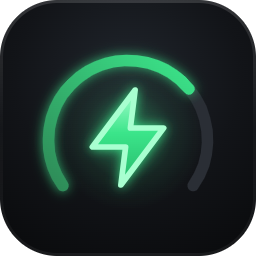

# Wallbox WEB for Home Assistant

🇮🇹 [Italiano](README.it.md)

[](https://my.home-assistant.io/redirect/hacs_repository/?owner=Filpin011&repository=ha-wallbox-web&category=integration)
[](https://my.home-assistant.io/redirect/config_flow_start/?domain=wallbox_web)
[](https://github.com/Filpin011/ha-wallbox-web/actions/workflows/validate.yml)
[](https://github.com/Filpin011/ha-wallbox-web/actions/workflows/tests.yml)

> **Independent, unofficial project.** It comes from a study of how the charging stations communicate on the local
> network (interoperability). **Not affiliated with, endorsed or supported by SCAME PARRE S.p.A.** "Scame" and
> related trademarks belong to their respective owners and are mentioned only to identify compatible devices. No
> warranty: use it at your own risk; work on the electrical installation must be done by qualified installers.
> Details: [DISCLAIMER.md](DISCLAIMER.md).

Custom integration that brings the charging stations managed by **Wallbox WEB** (the self-hosted web app for
Scame-compatible wallboxes on the local network) into Home Assistant. Every station becomes a **device** with
sensors, commands and the energy meter for the **Energy dashboard**. For a card with the app's look see
[wallbox-web-card](https://github.com/Filpin011/wallbox-web-card); the built-in Home Assistant cards work too
([examples below](#use-the-built-in-home-assistant-cards)).

The integration follows your Home Assistant language: **English** by default, **Italian** available.



## Requirements

- Home Assistant **2026.11** or later (HAOS, Container or Core).
- A **Wallbox WEB** server with API v1, either:
  - **self-hosted** (Docker, Coolify, …) and reachable from Home Assistant, e.g. `https://wallbox.example.com`;
  - the Home Assistant **add-on** ([ha-wallbox-web-addon](https://github.com/Filpin011/ha-wallbox-web-addon)),
    discovered automatically.
- For a self-hosted server: an **API token** created in the app (see below).

The integration never talks to the station directly: it goes through the server, which shares its single connection
to the station between the app, the charge recorder and Home Assistant.

## Installation

### With HACS (recommended)

1. Press **Open in HACS** above, or in HACS › ⋮ › **Custom repositories** add
   `https://github.com/Filpin011/ha-wallbox-web` with type **Integration**.
2. Search for **Wallbox WEB** › **Download**.
3. **Restart** Home Assistant (Settings › System › ⋮ › Restart).

### Manual (Samba / File editor / Studio Code Server)

1. Download the latest [release](https://github.com/Filpin011/ha-wallbox-web/releases) (`wallbox_web.zip`) and copy
   its content to `/config/custom_components/wallbox_web` (with the Samba add-on:
   `\\homeassistant\config\custom_components\`).
2. Restart Home Assistant.

## Configuration

### Self-hosted server

1. In Wallbox WEB, as administrator: **Menu › API tokens › +**, name `Home Assistant`, permissions
   **Read and commands** (or *Read only* if you only want the sensors). Copy the `wbx_…` token: it is shown only once.
2. In Home Assistant: **Settings › Devices & services › Add integration › Wallbox WEB** (or the button above).
3. Enter:
   - **URL**: the server address, e.g. `https://wallbox.example.com` (no trailing `/`);
   - **API token**: the `wbx_…` token;
   - **Verify SSL certificate**: leave it on; turn it off only for a self-signed certificate on your LAN.

### Add-on

Start the Wallbox WEB add-on: Home Assistant shows **"New device discovered: Wallbox WEB"** in Settings › Devices &
services. Press **Add** › **Submit**. Nothing to type.

### Revoked token or changed URL

- Token no longer valid → **Re-authentication required** notification: paste a new token.
- New server address → integration ⋮ › **Reconfigure**.

## What you get

One device per station (manufacturer, model, serial number, firmware, link to the station page in the app) with:

| Type | Entities |
|---|---|
| Sensors | Status, Power, Session energy, **Lifetime energy**, Session duration, Current L1 (L2/L3 on three-phase, disabled), Voltage (disabled), Max available power, Power limit, External power (disabled), Error, Active schedules, Last charge energy / cost / saving, Charge card (disabled) |
| Binary sensors | Plugged in, Charging, Problem, Schedule active, Reachable |
| Buttons | Start charging, Pause charging, Resume charging, Stop charging (available only when the action is possible) |
| Number | Max current (6 A … the station's maximum) |
| Select | Behaviour mode (Free / Personal) |

Stations added later appear automatically. Data updates are **pushed** (server events) with a fallback check every
30 seconds.

### Entity ids

Entity ids are built from the device name and the entity name in the language Home Assistant had when the station
was added. For a station named **Garage**:

| Entity | English | Italian |
|---|---|---|
| Status | `sensor.garage_status` | `sensor.garage_stato` |
| Power | `sensor.garage_power` | `sensor.garage_potenza` |
| Session energy | `sensor.garage_session_energy` | `sensor.garage_energia_ricarica` |
| Lifetime energy | `sensor.garage_lifetime_energy` | `sensor.garage_energia_totale` |
| Session duration | `sensor.garage_session_duration` | `sensor.garage_durata_ricarica` |
| Power limit | `sensor.garage_power_limit` | `sensor.garage_limite_di_potenza` |
| Last charge cost | `sensor.garage_last_charge_cost` | `sensor.garage_costo_ultima_ricarica` |
| Charging | `binary_sensor.garage_charging` | `binary_sensor.garage_in_carica` |
| Plugged in | `binary_sensor.garage_plugged_in` | `binary_sensor.garage_connessa` |
| Start / Pause / Resume / Stop | `button.garage_start_charging`, `…_pause_charging`, `…_resume_charging`, `…_stop_charging` | `button.garage_avvia_ricarica`, `…_pausa_ricarica`, `…_riprendi_ricarica`, `…_ferma_ricarica` |
| Max current | `number.garage_max_current` | `number.garage_corrente_massima` |
| Behaviour mode | `select.garage_behaviour_mode` | `select.garage_modalita_di_funzionamento` |

Check yours in Settings › Devices & services › Wallbox WEB › *your station*. The examples below use the English ids.

### Energy dashboard

Settings › Dashboards › **Energy** › *Individual devices* › **Add device** › choose **`<station> Lifetime energy`**
(`sensor.garage_lifetime_energy`; optional power for the live view: **`<station> Power`**). Use *Lifetime energy*
(always increasing), not *Session energy* (reset at every charge).

### Automation example

```yaml
alias: Notify me when charging ends
triggers:
  - trigger: state
    entity_id: binary_sensor.garage_charging
    from: "on"
    to: "off"
actions:
  - action: notify.mobile_app_phone
    data:
      message: >-
        Charge finished: {{ states('sensor.garage_last_charge_energy') }} kWh,
        {{ states('sensor.garage_last_charge_cost') }} €
```

## Use the built-in Home Assistant cards

Everything below works with the cards that ship with Home Assistant (no HACS needed). Replace `garage` with your
station's id. In a **sections** dashboard, paste each card in *Edit dashboard › ⋮ › Raw configuration editor* or
add the card from the picker and switch to the code editor.

### Tile cards with features

```yaml
# Live power with a 6 h trend and a bar gauge (0 … 7.4 kW)
type: tile
entity: sensor.garage_power
name: Garage
features_position: bottom
features:
  - type: trend-graph
    hours_to_show: 6
  - type: bar-gauge
    min: 0
    max: 7.4
```

```yaml
# Status with its per-state icon (charging, paused, faulted, unreachable, …)
type: tile
entity: sensor.garage_status
name: Garage
```

```yaml
# Start / Stop: the "button" feature presses the button entity (greyed out when the action is not possible)
type: tile
entity: button.garage_start_charging
name: Start charging
features:
  - type: button
    action_name: Start
```

```yaml
type: tile
entity: button.garage_stop_charging
name: Stop charging
features:
  - type: button
    action_name: Stop
```

```yaml
# Behaviour mode and max current
type: tile
entity: select.garage_behaviour_mode
features:
  - type: select-options
    style: buttons
```

```yaml
type: tile
entity: number.garage_max_current
features:
  - type: numeric-input
    style: buttons
```

### Gauge card

```yaml
type: gauge
entity: sensor.garage_power
name: Charging power
unit: kW
min: 0
max: 7.4          # your station's "Max available power"
needle: true
segments:
  - from: 0
    color: var(--info-color)
  - from: 1.4
    color: var(--success-color)
  - from: 6.9
    color: var(--warning-color)
```

### Entities card

```yaml
type: entities
title: Garage wallbox
entities:
  - entity: sensor.garage_status
  - entity: sensor.garage_power
  - entity: sensor.garage_session_energy
  - entity: sensor.garage_session_duration
  - entity: binary_sensor.garage_plugged_in
  - type: divider
  - entity: button.garage_start_charging
  - entity: button.garage_pause_charging
  - entity: button.garage_resume_charging
  - entity: button.garage_stop_charging
  - type: divider
  - entity: select.garage_behaviour_mode
  - entity: number.garage_max_current
  - type: divider
  - entity: sensor.garage_last_charge_energy
  - entity: sensor.garage_last_charge_cost
  - entity: sensor.garage_last_charge_saving
```

### History graph of the power

```yaml
type: history-graph
title: Charging power
hours_to_show: 12
entities:
  - entity: sensor.garage_power
  - entity: binary_sensor.garage_charging
```

### Statistics graph of the energy

```yaml
type: statistics-graph
title: Energy per day
entities:
  - sensor.garage_lifetime_energy
stat_types:
  - change
period: day
days_to_show: 30
chart_type: bar
```

### Energy dashboard and energy cards

Add `sensor.garage_lifetime_energy` to the Energy dashboard (see [Energy dashboard](#energy-dashboard)). Then the
energy cards show the charger next to the other devices, also outside the Energy dashboard:

```yaml
type: energy-devices-graph
```

```yaml
type: energy-devices-detail-graph
```

### Planned

Integration changes that would make the built-in cards better (not implemented yet):

- **`switch.<station>_charging`** (on = start / resume, off = stop), so the tile card's `toggle` feature and a
  single tap on the tile icon start and stop charging, instead of one tile per button.
- A state-dependent icon for **Power** and **Session energy** (e.g. `mdi:flash-off` while not charging), so a
  power tile shows idle vs. charging at a glance (the Status sensor already has per-state icons).
- Max current and behaviour mode as regular (non-*configuration*) entities, so they appear in the auto-generated
  dashboard and in area cards.

## Known limits

- A charge started with an RFID card may not be stoppable from Home Assistant (the station can refuse the command).
- If the server does not expose API v1 yet, setup answers "The server does not expose API v1": update Wallbox WEB.

## Troubleshooting

- **Cannot connect**: open the URL from a browser on the same network as Home Assistant; check the certificate and
  the port.
- **Buttons unavailable**: the token is read-only, or the action is not possible in the current state.
- **Diagnostics**: Settings › Devices & services › Wallbox WEB › ⋮ › *Download diagnostics* (tokens, addresses and
  serial numbers are redacted). Logs: ⋮ › *Enable debug logging*.

## Removal

Settings › Devices & services › Wallbox WEB › ⋮ › **Delete**; then remove the integration from HACS (or delete the
`custom_components/wallbox_web` folder) and revoke the token in the app.

## Development

See [CONTRIBUTING.md](CONTRIBUTING.md). Quick start: open in the dev container (or a Python 3.14 venv),
`scripts/setup`, `scripts/lint`, `scripts/test`, `scripts/develop` (Home Assistant on http://localhost:8123 with
this integration).

## License

[MIT](LICENSE)
